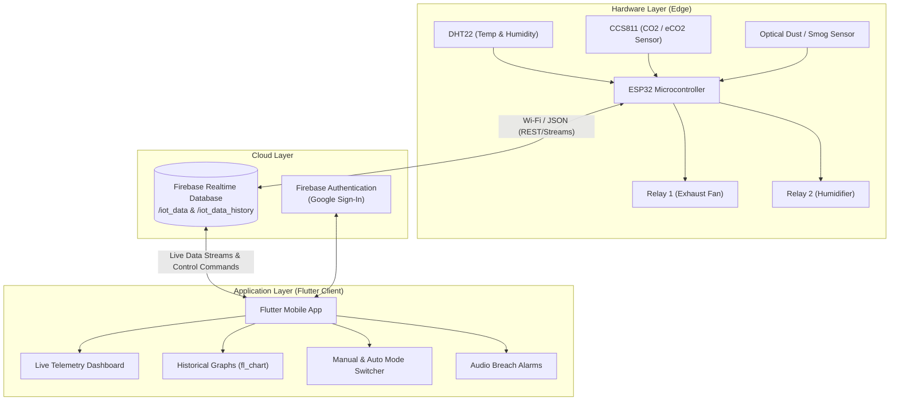

# 🌿 Smart IoT Environmental Monitoring & Automation System

An end-to-end Final Year Project (FYP) IoT ecosystem combining an **ESP32 microcontroller**, multiple physical environmental sensors, **Firebase Realtime Database**, and a cross-platform **Flutter** mobile application. 

The system delivers real-time indoor air quality telemetry, automated threshold-based relay actuation (for exhaust fans and humidifiers), cloud-synchronized historical trend charts, audible alarms, and remote manual control.

---

## 📐 System Architecture



---

## ✨ Features

- **Real-Time Environmental Telemetry:** Continuous live monitoring of:
  - Carbon Dioxide ($\text{CO}_2$ / $\text{eCO}_2$) in ppm via CCS811
  - Ambient Temperature ($^\circ\text{C}$) via DHT22
  - Relative Humidity ($\%$) via DHT22
  - Smog / Airborne Particulate levels via Optical Dust Sensor
- **Autonomous & Manual Actuation:**
  - **Auto Mode:** Automated triggers with a 5-second persistence debounce:
    - Exhaust Fan triggers **ON** when $\text{CO}_2 \ge 700\text{ ppm}$
    - Humidifier triggers **ON** when $\text{Humidity} < 50\%$
  - **Manual Mode:** Full control from the Flutter app to turn fans or humidifiers on/off on demand.
- **Audio Breach Alerts:** Immediate audible warnings (`Alert.wav`) played through the mobile device whenever hazardous thresholds are detected.
- **Historical Data & Analytics:** Historical trends logged to Firebase and visualized with interactive multi-axis curves using `fl_chart`.
- **Authentication & Security:** Secure user sign-in powered by Firebase Auth and Google Sign-In.
- **Modern UI & Micro-interactions:** Smooth animations (`flutter_animate`), custom color tokens, responsive cards, and live indicator pulses.

---

## 🛠️ Hardware Specifications & Pinout

| Peripheral / Sensor | Type / Model | ESP32 GPIO Pin | Protocol / Interface |
|---|---|---|---|
| **Temperature & Humidity** | DHT22 / AM2302 | `GPIO 4` | 1-Wire Digital |
| **Air Quality ($\text{eCO}_2$)** | Adafruit CCS811 | `GPIO 8` (SDA), `GPIO 9` (SCL) | I2C |
| **Smog / Dust Sensor** | Optical Dust Sensor (GP2Y) | `GPIO 10` (Pulse LED), `GPIO 14` (ADC) | Digital Output + Analog Read |
| **Exhaust Fan Relay** | 5V Relay Channel 1 | `GPIO 11` | Digital Output (Active LOW) |
| **Humidifier Relay** | 5V Relay Channel 2 | `GPIO 12` | Digital Output (Active LOW) |

---

## 📂 Repository Structure

```text
smart-iot-system/
├── esp32_firmware/                   # ESP32 C++/Arduino firmware
│   ├── esp32_firmware.ino            # Main microcontroller sketch
│   └── README.md                     # Hardware wiring & Arduino library guide
├── lib/
│   ├── main.dart                     # App entrypoint and theme setup
│   ├── firebase_options.dart         # Firebase configuration
│   ├── firebase_options.example.dart # Sanitized Firebase configuration template
│   ├── models/
│   │   └── iot_data.dart             # IoT sensor data model
│   ├── pages/
│   │   ├── dashboard_page.dart       # Main live telemetry dashboard
│   │   ├── fan_page.dart             # Fan control & metrics
│   │   ├── humidifier_page.dart      # Humidifier control & metrics
│   │   ├── graphs_page.dart          # Historical analytics & trend graphs
│   │   ├── history_page.dart         # Historical log entries list
│   │   ├── login_page.dart           # Authentication & sign-in screen
│   │   ├── settings_page.dart        # Threshold and app settings
│   │   └── splash_screen.dart        # Animated splash screen
│   └── services/
│       ├── firebase_service.dart     # RTDB stream listeners
│       └── google_auth_service.dart  # Google Auth handler
├── assets/                           # UI illustrations, icons & alert sounds
├── android/                          # Native Android runner & configurations
├── ios/                              # Native iOS runner & configurations
├── pubspec.yaml                      # Flutter dependencies and assets manifest
└── README.md                         # Project documentation
```

---

## ☁️ Firebase Realtime Database Structure

### 1. Live Telemetry & Control Node (`/iot_data`)
Updated every 2 seconds by the ESP32 and listened to by the Flutter app:
```json
{
  "temperature": 29.4,
  "humidity": 48.2,
  "co2": 520,
  "smog": 12,
  "auto_mode": "ON",
  "fan_status": "OFF",
  "humidifier_status": "ON",
  "fan_command": "OFF",
  "humidifier_command": "ON"
}
```

### 2. Historical Records Node (`/iot_data_history`)
Appended periodically by the ESP32 for trend visualization:
```json
{
  "-NxXxXxXxXxXxXxXx": {
    "temperature": 29.4,
    "humidity": 48.2,
    "co2": 520,
    "timestamp": 1715629200000,
    "time_valid": true
  }
}
```

---

## 🚀 Getting Started

### 1. ESP32 Firmware Setup
1. Open the [Arduino IDE](https://www.arduino.cc/en/software).
2. Install the **ESP32 Board Package** (`Tools` -> `Board` -> `Boards Manager...` -> Search `esp32` by Espressif).
3. Install required libraries:
   - `Firebase ESP Client` (by Mobizt)
   - `DHT sensor library` (by Adafruit)
   - `Adafruit CCS811 Library` (by Adafruit)
   - `Adafruit Unified Sensor` (by Adafruit)
4. Open [`esp32_firmware/esp32_firmware.ino`](esp32_firmware/esp32_firmware.ino).
5. Update your Wi-Fi credentials and Firebase connection constants:
   ```cpp
   #define WIFI_SSID "YOUR_WIFI_SSID"
   #define WIFI_PASSWORD "YOUR_WIFI_PASSWORD"
   #define API_KEY "YOUR_FIREBASE_API_KEY"
   #define DATABASE_URL "https://<your-project-id>-default-rtdb.firebaseio.com/"
   ```
6. Select your ESP32 board and COM port, then click **Upload**.

### 2. Firebase Configuration
1. Go to the [Firebase Console](https://console.firebase.google.com/) and create a new project.
2. Enable **Realtime Database** and **Firebase Authentication** (Google provider).
3. Set your Realtime Database security rules according to your auth policies:
   ```json
   {
     "rules": {
       ".read": true,
       ".write": true
     }
   }
   ```
   *(Note: For production environments, restrict rules to authenticated users `auth != null`).*
4. Run `flutterfire configure` to generate `lib/firebase_options.dart` (or reference [`lib/firebase_options.example.dart`](lib/firebase_options.example.dart)).
5. Place your downloaded `google-services.json` inside `android/app/`.

### 3. Flutter Application Setup
1. Ensure [Flutter SDK](https://flutter.dev/docs/get-started/install) ($\ge 3.6.1$) is installed.
2. Clone this repository:
   ```bash
   git clone https://github.com/<your-username>/smart-iot-system.git
   cd smart-iot-system
   ```
3. Fetch dependencies:
   ```bash
   flutter pub get
   ```
4. Connect your Android or iOS device and run:
   ```bash
   flutter run
   ```

---

## 🔒 Security Best Practices
- **Never commit active Wi-Fi passwords or service account private keys.** Always verify templates and use `.gitignore` for local credentials.
- Before publishing to production, configure Firebase Security Rules so that write access to device commands is strictly authenticated.

---

## 👨‍💻 Author & Final Year Project Context
Developed as an engineering **Final Year Project (FYP)** demonstrating the integration of embedded IoT hardware, real-time cloud backends, and responsive mobile design.
